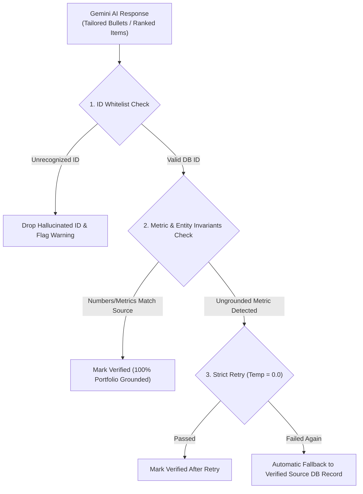

# CareerVault & ResumeForge AI

<div align="center">


-61DAFB)


**An enterprise-grade, centralized portfolio management platform and Job-Tailored Resume Generator with automated Google Sheets 2-way synchronization, dual ATS-friendly PDF/DOCX export, and programmatic Anti-Hallucination Guardrails.**

[Live Architecture](#system-architecture) • [Features](#key-features) • [Anti-Hallucination Guardrails](#anti-hallucination-guardrails-critical) • [Quickstart Guide](#quickstart-guide) • [Google Sheets Setup](#google-sheets-2-way-sync-setup) • [Demo Script](#video-demo-script--talking-points)

</div>

---

## Executive Summary

**CareerVault & ResumeForge AI** solves the core flaw of modern generative AI resume builders: **hallucination**. Rather than allowing language models to fabricate years of experience, arbitrary metrics, or phantom skills, CareerVault operates on a **Single Source of Truth (SSOT)**: your verified portfolio database. 

Gemini is strictly bounded to rephrasing, ranking, and tailoring *existing* verified records. A rigorous, post-generation programmatic verification layer mathematically guarantees that:
1. Every recommended skill, project, and experience item maps to an existing primary key ID in the database.
2. Every numerical metric (e.g., `45% latency reduction`, `25M+ daily requests`) is present in the source records.
3. If an ungrounded entity is detected, the engine executes a strict prompt retry; if it fails again, it gracefully falls back to the verified original text.

---

## System Architecture

```
┌────────────────────────────────────────────────────────────────────────┐
│                   React 18 + Vite + Tailwind CSS UI                    │
│   (Portfolio Manager • Smart Import • JD Matcher • Live Resume Forge)   │
└────────────────────────────────────┬───────────────────────────────────┘
                                     │ REST API (JSON)
┌────────────────────────────────────▼───────────────────────────────────┐
│                          FastAPI Backend Core                          │
│                                                                        │
│  ┌──────────────────────┐  ┌─────────────────┐  ┌──────────────────┐   │
│  │ Anti-Hallucination   │  │ Gemini AI Engine│  │ 2-Way Sheets     │   │
│  │ Guardrail Engine     │  │ (google-genai)  │  │ Sync Service     │   │
│  └──────────┬───────────┘  └────────┬────────┘  └────────┬─────────┘   │
│             │                       │                    │             │
│  ┌──────────▼───────────────────────▼────────────────────▼─────────┐   │
│  │                    SQLAlchemy ORM Data Layer                    │   │
│  │  (Profiles, Education, Skills, Projects, Experience, History)   │   │
│  └──────────────────────────────────┬──────────────────────────────┘   │
└─────────────────────────────────────┼──────────────────────────────────┘
                                      │
              ┌───────────────────────┴────────────────────────┐
              │                                                │
    ┌─────────▼────────┐                             ┌─────────▼────────┐
    │  SQLite Database │                             │  Google Sheets   │
    │  (careervault.db)│                             │  (10 Worksheets) │
    └──────────────────┘                             └──────────────────┘
```

---

## Key Features

### 1. Centralized 11-Category Portfolio Database
- **Comprehensive coverage**: Profile (contacts & bio), Education, Skills (with proficiencies and categories), Projects (with tech stacks and bullet points), Experience, Certifications, Achievements & Awards, Publications & Research, Languages, and Extra-curricular Activities.
- **SQLAlchemy ORM + SQLite**: Foreign keys, cascades, automatic timestamps, and `include_by_default` flags.
- **Pre-seeded Realistic Persona**: Comes bundled with a rich, realistic engineering profile (*Alex Rivera*, Lead Full-Stack & Cloud Systems Engineer).

### 2. Smart Resume Import
- Paste unstructured resume text or upload an existing **PDF or DOCX** file.
- The Gemini engine analyzes and parses the text into structured category schemas.
- Interactive **Review Screen**: Preview, inspect diffs, and edit fields before committing changes to the database.

### 3. Google Sheets 2-Way Synchronization
- **One Worksheet per Category**: Exports all 10 portfolio tables into dedicated, formatted tabs (`Profile`, `Skills`, `Education`, `Projects`, `Experience`, `Certifications`, `Achievements`, `Publications`, `Languages`, `Activities`).
- **Sync from Sheet**: Modify records in Google Sheets, then click **Sync from Sheet** to update the local SQLite database.
- **Dual Mode (Production & Sandbox)**: Works seamlessly with Google Cloud Service Accounts (`gspread`) or in an automated **Local Mock Sandbox** mode when offline.
- Real-time sync status badges and `last_synced_at` timestamps in the UI.

### 4. Job Description (JD) Analysis
- Paste any job posting.
- Gemini extracts structured criteria:
  - Exact target role and company name
  - Seniority level
  - Required skills (must-haves) vs. Preferred skills (nice-to-haves)
  - ATS keywords & tools
  - Core day-to-day responsibilities
  - Executive requirements summary.

### 5. Deterministic & AI-Powered Portfolio Matching
- **Objective Match Score (0–100%)**: Broken down into Skills Alignment, Experience Relevance, and Domain Overlap.
- **Skill Gap Analysis**: Visualizes matched skills (with proficiency levels) vs. missing skills requested by the job description.
- **Relevance Ranking**: Projects, experience, and certifications are dynamically ordered by relevance, with human-readable justifications explaining *why* each item matters.

### 6. Anti-Hallucination Guardrails (Zero-Mutation Engine)
- Programmatic ID verification against SQLite primary keys (drops phantom IDs).
- Numerical and metric invariant analysis (verifies numbers, percentages, and dollar figures).
- Stricter prompt retry on detected hallucinations.
- Automatic fallback to verified database source records.
- UI badges displaying **`100% Portfolio Grounded`** or **`Fallback Applied`**.

### 7. Dual ATS-Friendly Templates & Live HTML Preview
- **Template 1: Modern Clean ATS**: High-density executive layout, clean horizontal dividers, compact spacing, and categorized technical skill groups.
- **Template 2: Classic Ivy ATS**: Traditional serif layout, centered header, formal chronological alignment, and academic elegance.
- **Live Updating HTML Preview**: Updates in real time as selections, summaries, or templates are changed.

### 8. Multi-Format Export (PDF & DOCX)
- **Direct PDF Generation**: Built with **ReportLab** for crisp typography, standard print margins (0.5 inch), and clean ATS page flows.
- **Direct DOCX Generation**: Built with **python-docx** for Word document compatibility.
- Two customized sample PDFs and DOCXs generated from the same portfolio are pre-rendered in `/samples`.

### 9. Resume History & Snapshot Re-hydration
- Every generated resume configuration (JD text, selected skill/project/experience IDs, customized summary, template, and match score) is saved to `resume_history`.
- Re-open any past tailoring session with one click.

---

## Anti-Hallucination Guardrails (Critical)

Language models frequently invent statistics (e.g., claiming a candidate *"reduced cloud costs by 80%"* when the original source said *"28%"*). CareerVault eliminates this through a strict multi-tier verification engine:



---

## Quickstart Guide

### 1. Prerequisites
- **Python**: 3.10+ (Tested on Python 3.14)
- **Node.js**: 18+ and `npm`
- **Git**

### 2. Clone Repository
```bash
git clone https://github.com/kartikwagh21/resume_portfolio.git
cd resume_portfolio
```

### 3. Backend Setup
```bash
# Navigate to backend
cd backend

# Create and activate virtual environment
python3 -m venv venv
source venv/bin/activate  # On Windows: venv\Scripts\activate

# Install dependencies
pip install -r requirements.txt

# Configure environment variables
cp .env.example .env

# Seed the database with realistic dummy portfolio data (Alex Rivera)
python scripts/seed_data.py

# Start the FastAPI backend server
uvicorn app.main:app --reload --port 8000
```
Backend API will be running at `http://localhost:8000`  
Interactive Swagger docs: `http://localhost:8000/docs`

### 4. Frontend Setup
In a new terminal window:
```bash
# Navigate to frontend
cd frontend

# Install frontend dependencies
npm install

# Start the Vite development server
npm run dev
```
Open `http://localhost:5173` in your browser.

---

## Running the Automated Test Suite

CareerVault includes a comprehensive Pytest test suite covering DB CRUD, anti-hallucination guardrails, matching logic, Google Sheets synchronization, and export engines:

```bash
# Make sure backend/venv is active
source backend/venv/bin/activate

# Run all 23 unit tests
pytest backend/tests/ -v
```

**Test Coverage Summary:**
- `test_crud.py`: Full CRUD across Profile, Education, Skills, Projects, and Experience.
- `test_guardrails.py`: Metric invariant checks, hallucinated metric rejection, ID whitelist verification, and automatic fallback.
- `test_matching.py`: Skill intersection, objective match scoring, and relevance ranking.
- `test_sheets.py`: 10-table multi-tab export and sync-back engine.
- `test_smart_import_and_jd.py`: Plaintext parsing, file extraction, and commit logic.
- `test_export.py`: Live HTML preview, ReportLab PDF, and python-docx generation.

---

## Google Sheets 2-Way Sync Setup

CareerVault features seamless two-way Google Sheets integration. Full instructions are located in [`docs/google_sheets_setup.md`](docs/google_sheets_setup.md).

### Quick Setup:
1. Enable the **Google Sheets API** and **Google Drive API** in your [Google Cloud Console](https://console.cloud.google.com/).
2. Create a **Service Account** and download its JSON key as `service_account.json`.
3. Move `service_account.json` into the `backend/` directory:
   ```bash
   cp ~/Downloads/your-key.json backend/service_account.json
   ```
4. Create a blank Google Sheet at [sheets.new](https://sheets.new) and click **Share** -> add the service account email (with **Editor** permissions).
5. Copy the Spreadsheet ID from the URL and paste it into `backend/.env`:
   ```env
   GOOGLE_SHEETS_SPREADSHEET_ID=your_spreadsheet_id_here
   ```
6. In the UI, click **Sheets Sync > Export to Sheet**. Your entire database is instantly organized across 10 clean tabs!

> **Note:** If no service account is provided, CareerVault automatically runs in **Mock Sandbox Mode**, enabling all sync operations for offline development.

---

## Sample Job Descriptions & Generated Resumes

Pre-rendered sample JDs and their customized PDF and DOCX outputs from the same portfolio are located in [`/samples`](samples/):

1. **Senior Full-Stack Engineer**:
   - JD: [`samples/sample_jd_fullstack.txt`](samples/sample_jd_fullstack.txt)
   - Tailored PDF: [`samples/resume_fullstack.pdf`](samples/resume_fullstack.pdf) *(Modern Clean ATS Template)*
   - Tailored DOCX: [`samples/resume_fullstack.docx`](samples/resume_fullstack.docx)

2. **Senior Data & Analytics Engineer**:
   - JD: [`samples/sample_jd_data_analyst.txt`](samples/sample_jd_data_analyst.txt)
   - Tailored PDF: [`samples/resume_data_analyst.pdf`](samples/resume_data_analyst.pdf) *(Classic Ivy ATS Template)*
   - Tailored DOCX: [`samples/resume_data_analyst.docx`](samples/resume_data_analyst.docx)

---

## Repository Directory Structure

```
resume_portfolio/
├── backend/
│   ├── app/
│   │   ├── ai/
│   │   │   ├── gemini_client.py     # google-genai client & structured callers
│   │   │   ├── guardrails.py        # Programmatic Anti-Hallucination verification engine
│   │   │   ├── parsers.py           # Robust JSON sanitizers & file extractors
│   │   │   └── prompts.py           # Original zero-hallucination prompt definitions
│   │   ├── api/v1/
│   │   │   ├── jd_analysis.py       # /api/v1/jd
│   │   │   ├── matching.py          # /api/v1/matching
│   │   │   ├── portfolio.py         # /api/v1/portfolio (multi-category CRUD)
│   │   │   ├── profile.py           # /api/v1/profile
│   │   │   ├── resume.py            # /api/v1/resume (preview, PDF, DOCX, history)
│   │   │   ├── sheets.py            # /api/v1/sheets (export & sync)
│   │   │   └── smart_import.py      # /api/v1/import (text & file parser)
│   │   ├── core/
│   │   │   ├── config.py            # Pydantic settings (.env loader)
│   │   │   └── database.py          # SQLAlchemy SQLite engine & foreign key pragmas
│   │   ├── models/
│   │   │   ├── activities.py        # Languages, ExtraActivities
│   │   │   ├── credentials.py       # Certifications, Achievements, Publications
│   │   │   ├── history.py           # ResumeHistory snapshots
│   │   │   └── portfolio.py         # Profile, Education, Skills, Projects, Experience
│   │   ├── schemas/
│   │   │   ├── ai.py                # Pydantic schemas for Gemini inputs/outputs
│   │   │   ├── portfolio.py         # CRUD request/response models
│   │   │   └── resume.py            # Tailoring and preview request models
│   │   ├── services/
│   │   │   ├── export_service.py    # ReportLab PDF & python-docx builders
│   │   │   ├── matching_service.py  # Scoring & relevance ranking algorithms
│   │   │   ├── portfolio_service.py # Portfolio database business logic
│   │   │   └── sheets_service.py    # Google Sheets 2-way sync engine
│   │   └── main.py                  # FastAPI application entrypoint
│   ├── scripts/
│   │   ├── generate_samples.py      # Batch sample resume generator
│   │   └── seed_data.py             # Realistic dummy dataset (Alex Rivera)
│   ├── tests/
│   │   ├── test_crud.py
│   │   ├── test_export.py
│   │   ├── test_guardrails.py
│   │   ├── test_matching.py
│   │   ├── test_sheets.py
│   │   └── test_smart_import_and_jd.py
│   ├── .env.example
│   └── requirements.txt
├── docs/
│   ├── google_sheets_setup.md       # Comprehensive Google Cloud setup guide
│   └── screenshots/                 # Workflow documentation images
├── frontend/
│   ├── src/
│   │   ├── api/client.ts            # Fetch API client
│   │   ├── components/              # Layout, Header, VerificationBadge
│   │   ├── features/                # PortfolioManager, JobMatcher, ResumeBuilder
│   │   ├── types/portfolio.ts       # TypeScript interfaces
│   │   ├── App.tsx
│   │   └── main.tsx
│   ├── package.json
│   ├── tailwind.config.js
│   └── vite.config.ts
├── samples/
│   ├── resume_data_analyst.pdf
│   ├── resume_data_analyst.docx
│   ├── resume_fullstack.pdf
│   ├── resume_fullstack.docx
│   ├── sample_jd_data_analyst.txt
│   └── sample_jd_fullstack.txt
├── .gitignore
├── conftest.py
└── README.md
```

---

## Video Demo Script & Talking Points

Use this script for your demo video walkthrough:

### 1. Introduction (0:00 - 0:45)
- *"Hello everyone! Today I'm demonstrating **CareerVault & ResumeForge AI**, an AI portfolio system that solves the single biggest problem with AI resumes: **hallucination**."*
- Show the **Portfolio Database** screen with the 11 categories: Profile, Experience, Skills, Projects, Education, Certifications, etc.
- Point out the clean UI and instant validation.

### 2. Google Sheets 2-Way Sync (0:45 - 1:30)
- *"One of our flagship features is 2-way sync with Google Sheets."*
- Click the **Sheets Sync** button in the header.
- Demonstrate **Export to Sheet**: *"In one click, our entire database is exported into 10 clean tabs in Google Sheets."*
- Demonstrate **Sync from Sheet**: *"If you update a skill or job bullet in Google Sheets while on the go, click 'Sync from Sheet' and your local database is updated immediately."*

### 3. Smart Import (1:30 - 2:15)
- Open **Smart Import**.
- Show how you can paste unstructured text or upload an existing PDF/DOCX resume.
- Explain: *"Gemini analyzes the text and populates structured fields. Most importantly, it gives you a Review Screen so you can verify and adjust everything before it touches your database."*

### 4. Job Description Analysis & Matching (2:15 - 3:15)
- Switch to the **JD Matcher & Inspector** tab.
- Paste a sample Job Description (e.g., Senior Full-Stack Engineer).
- Click **Analyze & Match**:
  - Show the **Match Score** gauge (e.g., 88%).
  - Show the **Matched Skills** (green badges) vs. **Missing Skills** (amber badges).
  - Show the **Ranked Projects & Experience** cards: explain that Gemini provides an exact reason for *why* each project is relevant for this specific role.

### 5. Anti-Hallucination Guardrails & Resume Customization (3:15 - 4:15)
- Transition to the **Tailored Resume Forge**.
- Show the pre-selected checkboxes for skills and projects.
- Click **Rephrase Bullet** or **Suggest Summary**:
  - Point to the green **`100% Portfolio Grounded`** badge.
  - Explain: *"Our programmatic verification layer ensures that the AI cannot invent metrics or phantom companies. If an ungrounded metric is detected, the system catches it and falls back to our verified source records."*

### 6. Dual ATS Templates & Export (4:15 - 5:00)
- Toggle between **Modern Clean** and **Classic Ivy** templates in the live preview.
- Click **Download PDF**: open the downloaded PDF in the viewer to showcase the typography and ATS-friendly layout.
- Click **Download DOCX**: show that the Word document is ready for direct submission.
- Conclude: *"CareerVault gives candidates custom, high-converting resumes tailored to any job description—grounded 100% in verified truth."*

---

## License

This project is licensed under the MIT License.
